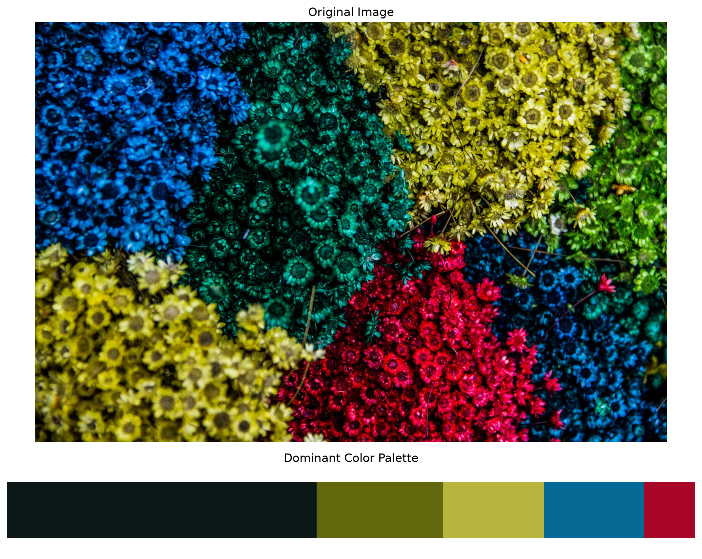

# Dominant Color Extraction using K-Means Clustering

A Python-based computer vision project that uses **K-Means clustering**, an unsupervised machine learning algorithm, to identify and visualize the dominant colours in an image.

The project processes RGB pixel data, groups similar colours into clusters, ranks them by frequency, and generates a proportional colour palette.

## Project Overview

Every pixel in an image contains colour information represented by RGB values. This project applies K-Means clustering to group pixels with similar colour characteristics.

The resulting cluster centroids represent dominant colours, while the number of pixels assigned to each cluster determines its relative prominence.

## Features

- Image loading and preprocessing using OpenCV.
- RGB pixel extraction and reshaping using NumPy.
- K-Means clustering using Scikit-learn.
- Dominant colour extraction through cluster centroids.
- Frequency-based ranking of extracted colours.
- RGB and HEX colour representation.
- Pixel-count and percentage analysis.
- Colour palette visualization using Matplotlib.
- Experimental Tkinter-based graphical interface.

## Project Structure

```text
Dominant_Color/
│
├── Color_extraction.py
├── Extraction.py
├── Extraction_GUI.py
├── result.md
├── README.md
├── .gitignore
│
└── results/
    └── dominant_color_extraction.png
```

### Python Scripts

| File | Description |
|---|---|
| `Color_extraction.py` | Main implementation using K-Means clustering, colour ranking and Matplotlib visualization. |
| `Extraction.py` | Alternative consolidated implementation of the colour extraction workflow. |
| `Extraction_GUI.py` | Experimental graphical interface using Tkinter for image selection and colour extraction. |

## Technologies Used

- Python 3.12
- OpenCV
- NumPy
- Scikit-learn
- Matplotlib
- Tkinter

## Installation

Clone the repository:

```bash
git clone https://github.com/Podiavaibhav/Dormant-Color.git
cd Dormant-Color
```

Create and activate a virtual environment:

```bash
python3 -m venv .venv
source .venv/bin/activate
```

Install dependencies:

```bash
pip install numpy opencv-python matplotlib scikit-learn
```

Tkinter is included with many Python installations. Availability depends on the Python distribution.

## Usage

### Main implementation

1. Open `Color_extraction.py`.
2. Update the `image_path` variable to point to your input image.
3. Set `num_colors` to choose the number of colour clusters.
4. Run:

```bash
python Color_extraction.py
```

The script displays the input image and extracted palette, and prints the ranked colours with RGB, HEX, pixel counts and percentages.

### Alternative implementation

```bash
python Extraction.py
```

### Graphical interface

```bash
python Extraction_GUI.py
```

The GUI implementation provides an image-selection workflow through Tkinter.

## Sample Results

The following results were generated using the main implementation with five colour clusters.

**Input image:** 0_9H74uSINU-qGHWz5.jpg

**Total pixels processed:** 2,666,000

| Rank | RGB | HEX | Pixel Count | Percentage |
|---:|---|---|---:|---:|
| 1 | (12, 23, 23) | `#0C1717` | 1,200,085 | 45.01% |
| 2 | (99, 104, 15) | `#63680F` | 490,126 | 18.38% |
| 3 | (183, 181, 61) | `#B7B53D` | 390,118 | 14.63% |
| 4 | (6, 105, 150) | `#066996` | 388,944 | 14.59% |
| 5 | (168, 6, 41) | `#A80629` | 196,727 | 7.38% |

### Visualization



Detailed output and configuration are available in [result.md](result.md).

## Algorithm

The project follows these steps:

1. Load the input image using OpenCV.
2. Convert the image from BGR to RGB.
3. Reshape the image into a two-dimensional array of RGB pixel values.
4. Apply K-Means clustering with a predefined number of clusters.
5. Extract cluster centroids as representative colours.
6. Count pixel assignments for each cluster.
7. Rank clusters by pixel frequency.
8. Visualize the resulting dominant colour palette.

## Current Configuration

| Parameter | Value |
|---|---|
| Algorithm | K-Means |
| Number of clusters | 5 |
| Random state | 42 |
| Colour space | RGB |
| Pixel processing | All image pixels |

## Limitations

- RGB Euclidean distance does not perfectly represent human colour perception.
- Processing every pixel can be computationally expensive for high-resolution images.
- The number of clusters must be specified beforehand.
- The main implementation currently uses a locally configured image path.

## Learning Outcomes

- Understanding unsupervised machine learning through K-Means clustering.
- Working with image data and RGB colour representations.
- Applying OpenCV for image processing.
- Using Scikit-learn for clustering.
- Analysing cluster distributions and visualizing extracted features.

---

**Project Type:** Beginner Computer Vision / Machine Learning

**Status:** Working initial implementation
