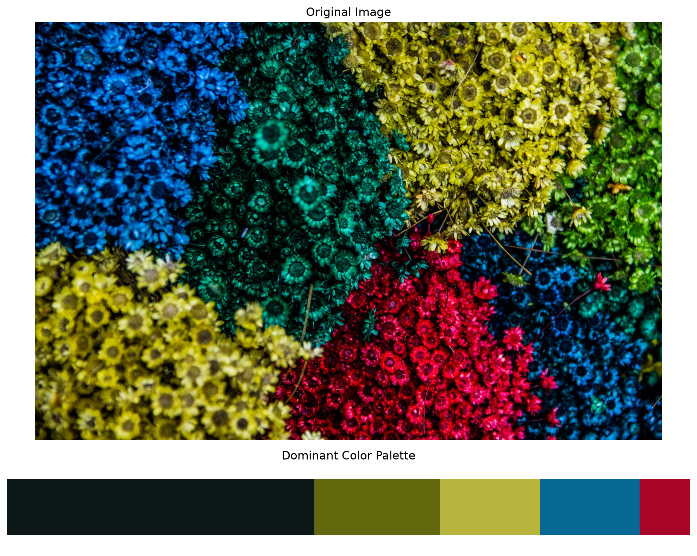

# Dominant Color Extraction — Results

## Overview

This project uses K-Means clustering to identify the five
most dominant colours in an input image.

## Input

- Image: `0_9H74uSINU-qGHWz5.jpg`
- Total pixels processed: 2,666,000
- Colour space: RGB
- Number of clusters: 5

## Algorithm Configuration

| Parameter | Value |
|---|---|
| Algorithm | K-Means |
| Number of clusters | 5 |
| Random state | 42 |
| Input data | RGB pixel values |
| Clustering approach | All image pixels |

## Extraction Results

| Rank | RGB | HEX | Pixel Count | Percentage |
|---:|---|---|---:|---:|
| 1 | (12, 23, 23) | #0C1717 | 1,200,085 | 45.01% |
| 2 | (99, 104, 15) | #63680F | 490,126 | 18.38% |
| 3 | (183, 181, 61) | #B7B53D | 390,118 | 14.63% |
| 4 | (6, 105, 150) | #066996 | 388,944 | 14.59% |
| 5 | (168, 6, 41) | #A80629 | 196,727 | 7.38% |

## Visualization

The following figure contains the original input image
and its extracted dominant colour palette.

## Environment

| Dependency | Version |
|---|---|
| Python | 3.12 |
| NumPy | 2.5.4 |
| OpenCV | 5.0.0 |
| Matplotlib | 3.11.2 |
| Scikit-learn | 1.9.1 |

## Notes

- Cluster colours are represented by their K-Means centroids.
- Pixel counts determine the ranking of dominant colours.
- Percentages are rounded to two decimal places.
- Results correspond to the specified input image and configuration.
